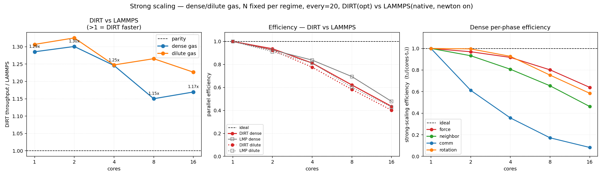
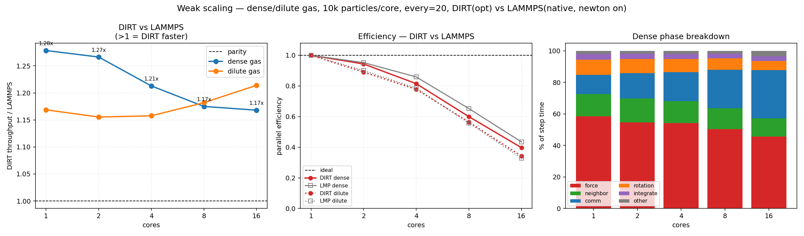

# perf_mpi_scaling — DEM throughput & MPI strong/weak scaling

> **On "is DIRT really beating LAMMPS?"** — a fair question, chased through three
> checks: (1) **`newton off`** — LAMMPS was on a full list; matched it to DIRT's half
> list (`newton on`), ~7–10 % faster. (2) **matched init** — identical sc-lattice
> positions + velocity distributions (verified same KE/atom). (3) **a real damping
> bug** — from identical init DIRT cooled ~5–9 % faster; root-caused to DIRT using the
> *linear* damping ratio on its *nonlinear Hertz* contact, fixed to the Tsuji
> polynomial LAMMPS uses (codes now agree to ~1 %, see Physics note). After all three,
> DIRT won dense (real kernel), dilute sat at ~parity (its earlier "win" was the
> over-damping artifact), and LAMMPS scaled better. The SOIL/DIRT comm, sort-cadence and
> dead-pass work since then changes that: **DIRT now leads LAMMPS 1.15–1.33× in every
> regime at every core count, with near-matching parallel efficiency** (see Findings).


A **performance** benchmark (not a validation one). It measures how fast DIRT
integrates a granular gas and how that rate scales with MPI ranks, and — when a
LAMMPS MPI binary is available — overlays LAMMPS on the *same* configs. No
correctness quantity is checked; the figure of merit is throughput.

> Unlike every `bench_*` example, a "FAIL" here means *poor scaling*, never a
> physics error. (The DIRT binary still records a conservation diagnostic per run
> — `n_global_start/end`, total KE — so a silently-broken decomposition is caught;
> every config in this example conserves at all rank counts.)

The headline driver is **`scaling_gas.py`**, which runs the two controlled
granular-gas regimes below in both scaling modes vs native LAMMPS and emits two
3-panel figures. (`sweep.py` is an older, more elaborate gas/bed driver kept for
reference; `scaling_gas.py` is the one these plots come from.)

## Two cost regimes (dense vs dilute gas)

Both are periodic cubes of frictional glass spheres with a random initial velocity
field, no gravity, no walls — identical Hertz–Mindlin contact, material, timestep,
and neighbor settings. Only the **volume fraction** differs, which flips the step
between the two cost regimes of DEM:

| regime | φ | neighbors/atom | bottleneck |
|---|---|---|---|
| **dense** | 0.50 | ~5.5 | the **Hertz–Mindlin force kernel** (contact-bound) — DIRT's strength |
| **dilute** | 0.05 | ~0.2 | **ghost comm + neighbor build** (overhead-bound) — LAMMPS's strength |

The reported quantity is **particle-steps per second**,

    particle_steps_per_s = N_global · steps_measured / wall_seconds,

a size-independent rate comparable across particle counts, rank counts, and codes.
`N_global` is obtained by an all-reduce, so it is correct under domain
decomposition. Only a **steady-state window** is timed (the recorder skips the
first 40 % — insertion, transient rebinning — barriers all ranks, then clocks the
remainder).

Beyond throughput, `scaling_gas.py` parses DIRT's per-system scheduler timings into
a **per-phase breakdown** (force / neighbor / comm / rotation / integrate), which
is what makes the *why* visible (see Findings).

## Material Properties

| property | value |
|---|---|
| radius | 1.1 mm (monodisperse) |
| density | 2500 kg/m³ (glass) |
| Young's modulus | 5×10⁷ Pa (softened) |
| Poisson ratio | 0.3 |
| restitution | 0.9 |
| friction | 0.3 |
| timestep | 6.386×10⁻⁶ s (**fixed, every case**) |
| neighbor skin / rebuild | 1.1 × diameter / every 20 steps (**fixed, both codes**) |

## Scaling modes

- **strong** — total particle count held fixed (= particles/core × max cores; ≈160k at a
  1→16 ladder, ≈400k at the 1→40 default), cores increased. Ideal: speedup = cores.
- **weak** — particle count *per core* held fixed (≈10k), domain and total N grow
  with cores. Ideal: flat throughput-per-core.

Default core ladder `1,4,8,16,32,40` (cluster-oriented; override with `PERF_RANKS`,
e.g. `1,2,4,8,16` on a laptop). Both codes are pinned to the *same* processor grid per case.

## Fairness — build LAMMPS native

DIRT is built `-C target-cpu=native`, so for an honest comparison LAMMPS must be
built with equivalent native tuning — **a Homebrew/apt bottle is a generic build**
and will understate LAMMPS (on Apple Silicon the gap is small; on x86 with AVX512
it is large). Build it and point `scaling_gas.py` at it:

```bash
git clone --depth 1 https://github.com/lammps/lammps && cd lammps
mkdir build && cd build
cmake ../cmake -D BUILD_MPI=on -D PKG_GRANULAR=on -D CMAKE_BUILD_TYPE=Release \
      -D CMAKE_CXX_FLAGS="-O3 -mcpu=native"     # use -march=native on x86
make -j
export PERF_LAMMPS=$PWD/lmp                     # scaling_gas.py picks this up
```

Two more matched settings, both in the generated LAMMPS input:

- **`newton on`** — LAMMPS uses a *half* neighbor list, matching DIRT, so each
  contact is evaluated once on both sides. (`newton off` builds a full list; for
  `pair_style granular` it gives bit-identical physics but ~7–10 % slower, which
  would unfairly favor DIRT — don't use it.)
- **matched cutoff / rebuild** — `neighbor 0.1·D` + `neigh_modify every 20` mirror
  DIRT's `skin_fraction 1.1` + `every 20`.

## How to Run

`scaling_gas.py` is a **directory-per-simulation** driver. `generate` lays out one
self-contained job dir per (code, mode, regime, cores) under `runs/` — each with its
config, matched init, and a `pbs_submit` that **`mpirun`s the binary directly** (no
python at run time). Raw outputs (`perf_*.csv`, `lammps_*.log`, `run_*.log`) stay in
the dir; `graph` parses them. Same flow on a laptop or a PBS cluster.

```bash
cargo build --release --example perf_mpi_scaling --features mpi_backend   # build DIRT (native: RUSTFLAGS=-C target-cpu=native)

# --- laptop ---
python3 examples/perf_mpi_scaling/scaling_gas.py all        # generate + run every case here + graph
python3 examples/perf_mpi_scaling/scaling_gas.py graph      # re-plot from runs/<dir>/ outputs, no sims

# --- supercomputer (PBS) ---
PERF_RANKS=1,4,8,16,32,40 \
  PERF_DIRT=/path/to/dirt/target/release/examples PERF_LAMMPS=/path/to/lammps/build \
  PBS_MODEL=rom14 PBS_NCPUS=128 PBS_GROUP=s1234 PBS_QUEUE=normal PBS_WALLTIME=00:30:00 \
  PBS_MODULES_DIRT='module load mpi-hpe/mpt' \
  PBS_MODULES_LAMMPS=$'module load mpi-hpe/mpt\nmodule load lammps' \
  python3 examples/perf_mpi_scaling/scaling_gas.py generate   # build dirs + pbs_submit + start_all.sh
bash examples/perf_mpi_scaling/start_all.sh                   # qsub every job
# ... wait for the queue ...
python3 examples/perf_mpi_scaling/scaling_gas.py graph        # plot whatever has finished
```

Each `runs/<code>_<mode>_<regime>_c<cores>/pbs_submit` sets `-N <name>`,
`-l select=<nodes>:ncpus:mpiprocs:model`, `-l walltime`, `-q <queue>`, `-W group_list`,
pastes in the code's module-load block, then runs `mpirun -np <cores> <binary> …` for
`PERF_REPS` reps. Partial results plot fine — `graph` reads whatever outputs exist.

### Knobs (environment variables)

| var | default | purpose |
|---|---|---|
| `PERF_RANKS` | `1,4,8,16,32,40` | core ladder; any count auto-decomposes (e.g. `40 → 5×4×2`) |
| `PERF_REPS` | `3` | mpirun reps per job; the **median** is reported |
| `PERF_NCORE` | `10000` | particles per core (weak) / per-core basis for the strong total |
| `PERF_STEPS` | `5000` | steps per run |
| `PERF_NEIGH_EVERY` | `20` | neighbor rebuild cadence (both codes) |
| `PERF_MODES` / `PERF_REGIMES` | `strong,weak` / `dense,dilute` | subset the sweep |
| `PERF_DIRT` | *(built path)* | DIRT binary — a **directory** (finds `perf_mpi_scaling`) or a full path |
| `PERF_LAMMPS` | `lmp_mpi` | LAMMPS binary — a **directory** (finds `lmp`/`lmp_mpi`) or a full path |
| `PERF_MPI` / `PERF_MPI_NP` | `mpirun` / `-np` | MPI launcher and its rank flag (`<MPI> <NP> <cores> …`) |
| `PBS_MODULES_DIRT` / `PBS_MODULES_LAMMPS` | *(PBS_MODULES)* | module-load block pasted into each code's `pbs_submit` |
| `PBS_MODEL` `PBS_NCPUS` `PBS_GROUP` `PBS_QUEUE` `PBS_WALLTIME` | `rom14` `128` `GROUP_ID` `normal` `00:30:00` | PBS job directives baked into every `pbs_submit` |

## Expected Plots

Each is a 3-panel figure: DIRT(optimized) vs native LAMMPS, dense + dilute.

**Strong scaling** (fixed total N; figures shown are cores 1→16 on the 18-core laptop):



(1) DIRT/LAMMPS throughput ratio vs cores, (2) parallel efficiency `speedup/cores`,
(3) **dense per-phase strong-scaling efficiency** `t₁/(cores·tₙ)` — the force line
riding the ideal while the comm line peels away below it (it fully collapses
only at higher core counts — run the ladder out on a server to see it).

**Weak scaling** (fixed ≈10k particles/core, total grows with cores; figures shown are 1→16):



(1) DIRT/LAMMPS ratio, (2) weak efficiency (throughput-per-core retention),
(3) **dense phase breakdown** — comm's share of the step climbing with core count
(modest over 1→16 on a laptop; pronounced once you run the ladder out on a server).

## Findings (Apple M5 Pro, 6 P + 12 E cores; strong N=157,464, weak ≈10k/core)

DIRT ÷ native LAMMPS (stable 22Jul2025 update 4, `-O3 -mcpu=native`), both **`newton on`**
(half list), matched init, both with **identical (Tsuji) contact physics** — they agree
to ~1 % in a Haff-cooling test (see Physics note). DIRT at SOIL `c3dff02` / GRASS main
(`f928e5c`). The two codes run interleaved case by case under `caffeinate`, on AC power,
nothing else heavy running. **3-rep medians, cores 1–16:**

| cores | strong dense | strong dilute | weak dense | weak dilute |
|---:|:---:|:---:|:---:|:---:|
| 1 | 1.29× | 1.31× | 1.28× | 1.17× |
| 2 | 1.30× | 1.33× | 1.27× | 1.16× |
| 4 | 1.25× | 1.25× | 1.21× | 1.16× |
| 8\* | 1.15× | 1.27× | 1.17× | 1.18× |
| 16\* | 1.17× | 1.23× | 1.17× | 1.21× |

Throughput behind the ratios (M particle-steps/s, LAMMPS / DIRT):

| cores | strong dense | strong dilute | weak dense | weak dilute |
|---:|:---:|:---:|:---:|:---:|
| 1 | 19.4 / 25.0 | 56.7 / 74.1 | 21.9 / 28.0 | 64.1 / 74.9 |
| 4 | 65.1 / 81.1 | 184 / 230 | 75.2 / 91.2 | 202 / 233 |
| 16\* | 149 / 174 | 388 / 476 | 152 / 178 | 338 / 410 |

`*` This machine has only 6 P-cores, so the 8- and 16-rank points include E-cores.
Absolute efficiency there is hardware-limited, but the **ratio is still meaningful**
because both codes pay the same E-core penalty and it cancels.

- **DIRT now wins every regime.** Dense (contact-bound) is the force kernel, as before.
  Dilute moved from ~0.9× to 1.16–1.33× once three per-step overheads came out. Removing
  them cut DIRT's serial strong-dilute step from 14.8 s to 10.7 s (LAMMPS: 14.4 s):
  - atom sorting is now once per `sort_every` steps, not every neighbor rebuild
    (`sort_atoms_by_bin` 2.30 → 0.09 s);
  - the gravity pass is skipped when g = 0 (1.45 → 0 s);
  - the wall pass is skipped when no wall is active (0.45 → 0 s).
- **Comm no longer runs away.** Against DIRT before the SOIL comm work, comm time at
  16 ranks fell to 0.25–0.41× (strong dense 4.53 → 1.83 s), and DIRT throughput rose
  1.3–2.0× at high core counts.
- **Parallel efficiency is now close to LAMMPS's.** On P-cores only, strong efficiency at 4
  cores is 0.81 (DIRT) vs 0.84 (LAMMPS) dense and 0.78 vs 0.81 dilute; weak dilute is
  even (0.78 vs 0.79). LAMMPS keeps a small edge in dense, which is why the dense ratio
  eases from 1.3× serially to ~1.17× at 8–16 ranks. Comm time stays roughly flat as
  ranks are added in strong scaling (about 2 s for dense at 1 and 16 ranks), so it
  remains the phase that limits strong scaling.

### Why DIRT wins dense — a per-phase autopsy (1 core, no MPI confound)

The throughput ratio is one number; the per-system timers say *where* it comes from. A
single serial dense run (10,648 spheres, 5,000 steps, `newton on` both codes, matched
init) splits as:

| phase | DIRT | LAMMPS (native) | ratio |
|---|---:|---:|:--:|
| **force / `Pair`** | **0.94 s** | **1.43 s** | **DIRT 1.53×** |
| neighbor / `Neigh` | 0.35 s | 0.35 s | tie |
| integrate + rotate / `Modify` | 0.29 s | 0.43 s | DIRT 1.5× |
| **comm / `Comm`** | **0.40 s** | **0.20 s** | **LAMMPS 2.0×** |
| total step | 2.12 s | 2.43 s | DIRT 1.15× |

Three facts follow, and together they *are* the explanation:

1. **The win is the force kernel, and nothing else.** DIRT evaluates the Hertz–Mindlin
   contact ~1.5× faster per step. In the dense regime force is ~half the step, so that
   one factor carries the whole dense lead. The hypothesis for *why* is structural, not a
   lucky constant: DIRT's `hertz_mindlin_contact_force`
   (`crates/dirt_granular/src/contact.rs`) is a **single monomorphized kernel** over
   struct-of-arrays atom data, with every pairwise material constant (`e_eff_ij`,
   `g_eff_ij`, `beta_ij`) precomputed into flat tables; LAMMPS `pair_style granular` is a
   **general dispatcher** that selects the normal/tangential/damping/rolling sub-models at
   runtime and pays per-pair indirection for that generality. Specialized DEM kernel vs
   general-purpose code — the classic trade, and here it costs LAMMPS ~50 % on the contact
   loop.
2. **It is not a cheaper problem.** DIRT carries the *larger* neighbor list — 31,944 pairs
   vs LAMMPS's 28,800 at a matched cutoff (1.1·D both) — and the two codes' Haff cooling
   tracks to ~1 % (Physics note). DIRT does equal-or-more work and still finishes the
   kernel faster; the speed is in the kernel, not in skipped contacts.
3. **Comm is DIRT's weak phase — which is exactly why LAMMPS scales better.** Even
   serially, where "comm" is only periodic ghost borders + reverse-force (no network),
   DIRT spends 2× what LAMMPS does. Comm is overhead that grows with rank count, so as
   cores climb it claims an ever-larger share of DIRT's step and erodes the force-kernel
   lead (the weak-scaling phase panel shows force flat, comm rising). The dilute regime is
   comm/neighbor-bound from the start, which is why it lands at parity.

**Two honesty caveats on the headline ratio.** (a) DIRT times only the steady-state
window (it skips the first `WARMUP_FRACTION`); LAMMPS's `Loop time` averages the whole
run. Compared like-for-like over full runs (424 vs 486 µs/step) the serial dense lead is
1.15×, not the 1.23× the steady window reports — a ~7 % measurement-window effect *on top
of* the real kernel advantage. (b) Native-vs-generic LAMMPS is only a ~2 % effect *on this
Apple-silicon machine* (generic `Pair` 1.47 s vs native 1.43 s); on x86 with wide SIMD it
can be much larger, so a fair comparison there demands a `-march=native` LAMMPS (see
Fairness) before any kernel-speed claim is read off.

> ### Physics note — the damping fix (important)
> An early version of this comparison showed DIRT ~5–9 % *colder* than LAMMPS from
> identical initial conditions — a real bug, not chaos. DIRT was applying the *linear*
> spring-dashpot damping ratio `β = -ln(e)/√(π²+ln²e)` to its *nonlinear Hertz* contact,
> which over-damps fast collisions (velocity-dependent restitution). Fixed to the
> **Tsuji-1992 polynomial** (`β = α(e)/√5`, exactly what LAMMPS `damping tsuji` uses)
> for the Hertz model; the two codes now track to ~1 % through a full cooling run.
> This **also** explains the benchmark history: the prior dilute "win" was DIRT's
> too-cold gas doing less work, and it vanished once the physics was corrected. The
> earlier `newton off` setting separately inflated the dense lead further; fair
> `newton on` + correct damping leaves a genuine **~1.3–1.5× dense kernel advantage** and
> **dilute parity** — LAMMPS's parallel efficiency remaining the better of the two.

## Assumptions / caveats

- **Heterogeneous cores limit high-rank *efficiency* measurements.** This M5 Pro has
  only **6 performance + 12 efficiency cores**; once the rank count exceeds 6, the extra
  ranks land on 2–3× slower E-cores, and since every MPI step synchronizes, the slowest
  rank gates the step. So absolute parallel efficiency above 6 ranks measures core
  heterogeneity, not scaling. **The DIRT/LAMMPS *ratio* still holds** at 8/16 ranks —
  both codes pay the same E-core penalty and it cancels — which is why the dense ~1.3–1.5×
  result is stable across the whole ladder; but the trustworthy *efficiency/scaling-slope*
  numbers are the ≤6-rank (P-core) points. **Real strong/weak scaling needs a
  homogeneous-core server/cluster** (`PERF_RANKS=1,4,8,16,32,40`).
- **Fairness rests on matched work + matched build.** Same Hertz contact, timestep,
  and neighbor cadence both sides; LAMMPS built native (see above).
- LAMMPS builds its own packing (N, density, contact model, decomposition, and step
  count matched — not the exact microstate). Sufficient for a throughput benchmark.
- `scaling_gas.py` reports a **3-rep median** per point by default (`PERF_REPS`). For
  publication numbers, also pin ranks to physical cores and prefer a quiet,
  homogeneous-core machine.

## References

- LAMMPS `granular` pair style (Hertz–Mindlin), matched to the contact model
  cross-validated in `bench_oblique_impact` and `bench_hertz_rebound`.
- Standard DEM scaling methodology (strong/weak scaling; particle-steps/s as the
  throughput metric).
